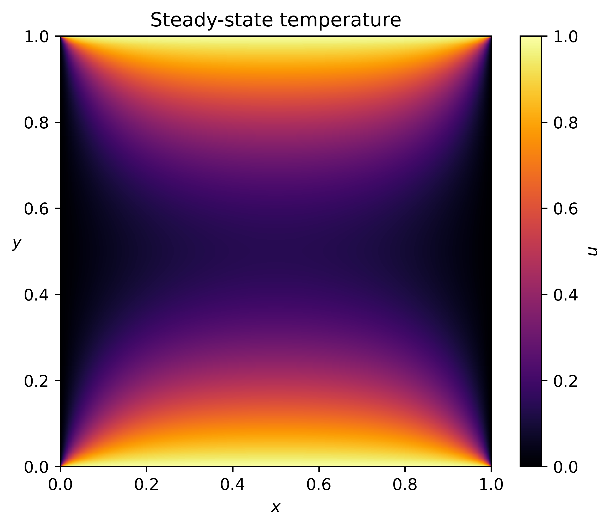
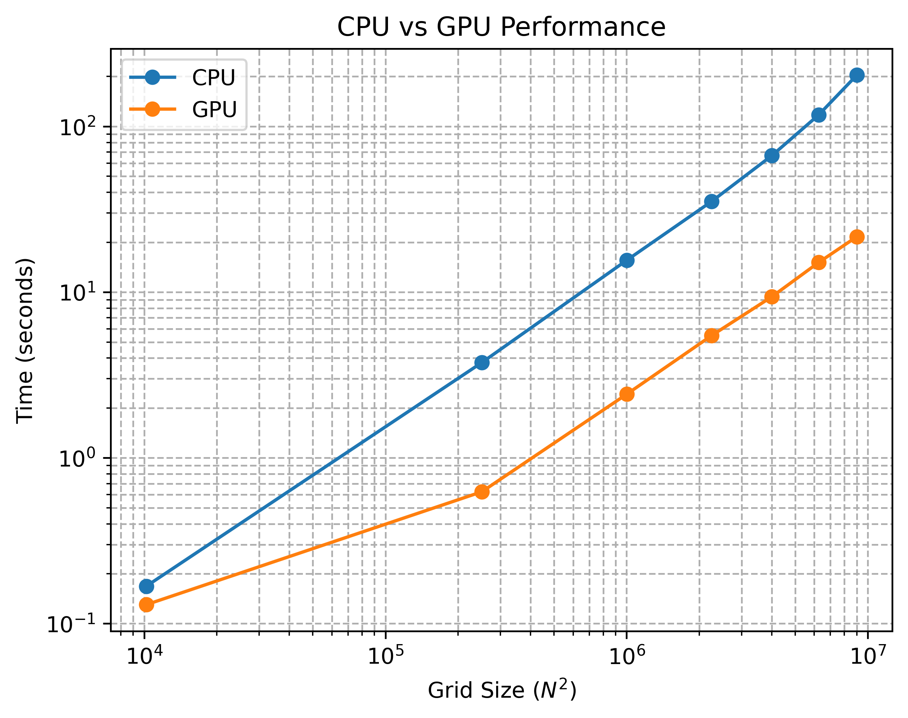

## Overview
A 2D explicit finite-difference solver for the linear heat equation, written in C++ and CUDA, used to study how a memory-bound stencil kernel performs on a GPU compared with a CPU. 
The solver is verified against an exact value and benchmarked from 10K to 9M grid points.

## Problem and Method
The solver integrates the linear heat equation $$u_t = \alpha \nabla^2 u$$ on the unit square, with $$u = 1$$ on the top and bottom walls and $$u = 0$$ on the sides. 
Space is discretized with the standard 5-point Laplacian and time with forward Euler:

$$u_{i,j}^{n+1} = u_{i,j}^n + \gamma \left(u_{i+1,j}^n + u_{i-1,j}^n + u_{i,j+1}^n + u_{i,j-1}^n - 4u_{i,j}^n\right), \quad \gamma = \frac{\alpha \Delta t}{h^2}$$

The time step is chosen from the Von Neumann stability condition, which requires $$\gamma \leq 1/4$$ (I use $$\gamma = 0.2$$).

## Verification
By superposition and symmetry, the steady-state temperature at the domain center is exactly 0.5, and this holds for the discrete equations as well. 
Both the CPU and GPU solvers converge to this value and agree with each other to all printed digits. 

## Implementation
- **GPU:** one thread per grid point, with the fast thread index mapped to the contiguous array index so memory accesses coalesce. Each time step is one kernel launch, and two buffers are swapped between steps, so no thread ever reads a value updated in the same step.
- **CPU baseline:** the same two-buffer scheme in C++, compiled with `-O3`, on a single core.

## Performance
Benchmarked on one MIG slice (one quarter) of an NVIDIA A30, against a single CPU core. 

Here I ran $$N_t=50000$$ steps for grids of size $$N^2$$ from $$N=101$$ to $$N=3001$$, and measured the simulation time and estimated the bandwidth. The solver operates on single-precision floats, so each step reads and writes $$N^2$$ floats, or $$4N^2$$ bytes. The bandwidth at each time step is then estimated as
$$\begin{equation*}
\text{bandwidth} = \frac{2\cdot 4N^2 \cdot N_t}{t_\text{total}}
\end{equation*}$$
The factor of $$2$$ accounts for $$1$$ reading of the previous time step for computing Laplacian and $$1$$ writing of the new time step. The speedup shown below is the ratio of CPU time to GPU time.

| Grid | CPU per step | GPU per step | CPU bandwidth | GPU bandwidth | Speedup |
|---|---|---|---|---|---|
| 101² | 3.4 µs | 2.6 µs | 24 GB/s | 31 GB/s | 1.3× |
| 501² | 75 µs | 12.5 µs | 27 GB/s | 161 GB/s | 6.0× |
| 1001² | 312 µs | 48 µs | 26 GB/s | 165 GB/s | 6.4× |
| 1501² | 706 µs | 109 µs | 26 GB/s | 165 GB/s | 6.4× |
| 2001² | 1,334 µs | 188 µs | 24 GB/s | 171 GB/s | 7.1× |
| 2501² | 2,346 µs | 302 µs | 21 GB/s | 166 GB/s | 7.8× |
| 3001² | 4,079 µs | 432 µs | 18 GB/s | 167 GB/s | 9.4× |

- The peak memory bandwidth of a quarter of NVIDIA A30 is approximately 933/4 = 233.25 GB/s, and the GPU bandwidth is roughly constant at 160-170 GB/s. The GPU operates at roughly 70% of peak bandwidth. 
- Our Forward Euler and 5-point stencil performs about 7 flops per grid point, which moves roughly 8 bytes (4 read + 4 write) per grid point, so the arithmetic intensity is about 0.875 flops/byte, which is far below the (quarter of) A30's balance point (10.3 TFLOPS / 933 GB/s $$\approx$$ 11 flops/byte). Therefore, this is a memory-bound kernel.

